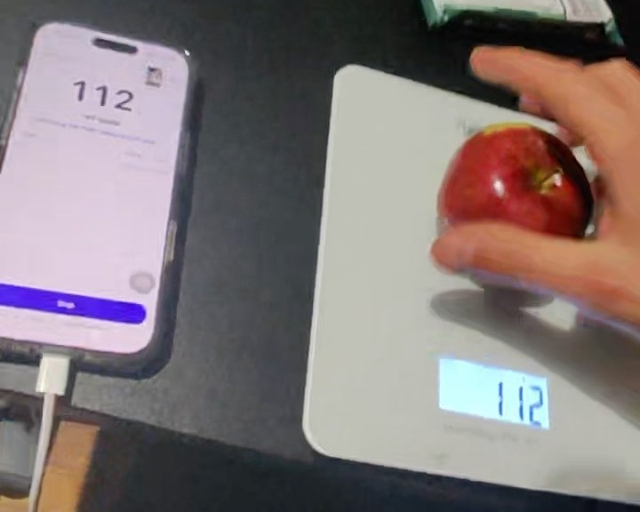

# itlogs.food

**The pain:** logging food means typing every meal, and the typing kills the habit. Photo apps skip the typing but guess the portion: four popular ones logged calories and fat about one-third too low across about 100 meals ([study led by an NIH fellow, presented at the American Society for Nutrition's annual meeting](https://www.westnewsmagazine.com/health/ai-calorie-tracking-apps-may-be-inaccurate-tests-find/article_fd5c470b-6cc5-5240-bdaf-c38366e01239.html)).

**The fix:** wear Ray-Ban Meta glasses and put the food on any digital scale. The glasses read the grams off the display, Muse Spark names the food, and the meal goes to Apple Health with its calories and macros. No typing, hands free, nothing to pair with the scale.

[](https://www.youtube.com/watch?v=JwRrb7FgCuk)

*The demo, 2:50, on YouTube.*



*A real frame from the glasses during a run, cropped. The app and the scale both say 112 g.*

Meta Global AI Developer Hackathon entry, Indie track, problem statement "Build for Your World". Site: https://itlogs.food


**Try it with no glasses and no key:** `make setup replay` runs the reads of real recorded sessions through today's logic and prints what the app logged then next to what it logs now. It needs no network, and CI fails if a row changes.

**Reading this with an LLM or an agent?** Start at [AGENTS.md](AGENTS.md): read order, module map, and a command to check each claim below.

## Compared

| | **itlogs.food** | Qalzy | Photo apps | Typing apps | Smart scales |
|---|---|---|---|---|---|
| What you need | Ray-Ban Meta glasses, any digital scale, an iPhone and, today, a Mac | Its own scale | A phone | A phone | Its own scale and a phone |
| Weighs, does not estimate | ● | ● | ○ | ○ | ● |
| Names the food with AI | ● | ● | ● | ○ | ○ |
| Weighs and names in one step | ● | ● | ○ | ○ | ○ |
| Works with the scale you already own | ● | ○ | ○ | ○ | ○ |
| Hands free while weighing | ● | ◐ | ○ | ○ | ○ |
| No phone in your hand while weighing | ● | ● | ○ | ○ | ○ |
| Goes to Apple Health | ● | ● | ◐ | ◐ | ◐ |
| Names packaged food and finds its label | ● | ● | ◐ | ● | ◐ |

● yes, ◐ partly or it varies, ○ no. In itlogs.food you tap Start, Stop and send on the phone, and nothing for each food. It reads a packaged food's wrapper instead of a barcode, and the first lookup of a product takes 30 to 60 s. Qalzy's column comes from [its own guide](https://qalzy.com/pages/scale-guide) and site, read 2026-NOVEMBER-04: you press a button on the scale for each scan, or twice for a Live Scan. Qalzy is a product on sale; itlogs.food is a hackathon build, run so far by its developer.

## Where it stands (2026-NOVEMBER-04)

| Capability | State | Evidence |
|---|---|---|
| Start, weigh single foods, Stop, review, send to Apple Health | **Works on real glasses in good light** | Best run, tag `best-run-2026-11-03`: apple 112 g, banana 124 g, 37 s from Start to the end, both foods in Health |
| Any digital scale | **Built for any, proven on one so far** | It reads the display and pairs with nothing, so nothing here is specific to one scale. Every recorded run used the same backlit scale |
| One row per food | **Works**, and old bugs are pinned | `make replay` on real recorded reads |
| A dim room | **Fails**: the digits wash out | 102 reads, 1 with a weight ([recorded runs](evals/recorded-runs.org)). The screen and the ear say the display is lost |
| A bowl, one row per ingredient | **Grams proven on real reads; one real dish named from speech; a full bowl not yet run** | Replay gives 104 g where the app had logged 265 g. An esfiha on a plate logged 117 g, named from what the wearer said |
| Foods the table does not know | **Works on a real frame; values are typical, not measured** | Muse Spark's web search took "Brazilian Sijah", a misheard word, plus what the camera saw, and returned "esfiha de carne" with typical values, in 32 s. The grams are the scale's; the macros are as good as the source |
| Packaged food, read off its wrapper | **Works on real frames** | On a live frame from the glasses, Muse Spark read the brand, the flavour, 40 g and 13 g protein. Its web search then found the label: 160 kcal and 7 g fat in both searches, with carbs at 15 and 17 g (the wrapper says 17), in 32 and 56 s, checked against what the wrapper prints. A product once found is instant |
| Spoken input | **Heard live, commands not exercised live** | The glasses' recognizer delivered speech in real runs. The parser is tested on mocked responses |
| "Hey Meta, start" launch | **Built, not working yet** | `VoiceInvocations.swift`; needs a Wearables Developer Center release channel |
| Accuracy against ground truth | **Not measured yet** | `evals/sets/` is empty, so `make eval` reports no sets |

## Why this approach

Smart scales weigh correctly, then make you pick the food by hand on a phone. Meta announced food logging by photo for its glasses in 2026: US only, estimated portions, in the Meta AI app. So the glasses read the number on the scale you already own. The scale supplies the grams, the glasses supply the picture, the model supplies the food's name, a table or a web search supplies the nutrients, and nobody types. [What Meta has said, and the prior art](docs/prior-art.org).

## How a food gets logged

This is the path the app uses from Start to Stop.

1. **Start** opens one WebSocket to the server and starts the glasses' video stream: 720 x 1280 at 7 fps, which the toolkit lowers to 504 x 896 when Bluetooth is tight (`GlassesSource.swift`).
2. **Which frame:** the server compares thumbnails frame by frame. It only spends a model call once the scene has been still for 0.6 s, and it picks the sharpest recent frame (`frames.py`). If the scene never settles, it reads anyway after 4 s.
3. **The read:** Muse Spark gets that frame and a JSON schema, and returns `food`, `display_value`, `unit`, `confidence` and `container` (`MetaReader.read_entry`). A median read takes 3.0 s. Reads run in the background, at most two at a time, so frames keep flowing.
4. **The decision** (`Session._watch`), with nobody asked:
   - One read at confidence 0.8 or above on a still scene logs the food. Otherwise two reads in a row must agree on the food and on the grams within 1 g.
   - A new read of the same food, with no empty scale in between, **corrects** that row instead of adding one.
   - The same grams under another name with no empty scale in between is the same item, because two foods cannot show the same weight without the scale passing through empty.
   - Two empty reads in a row mean a new food can come. One alone is a hand over the display.
5. **A bowl** (`Session._bowl_step`): once the reader sees a vessel, each rise on the scale is one ingredient, with only the grams it added. A tare keeps the count going. One model call names the ingredient from what was said if that names a food, and otherwise by comparing the bowl before and after (`MetaReader.read_addition`).
6. **Nutrients** (`nutrients.py`): grams times a per-100 g row from the Canadian Nutrient File (5,690 foods), through a curated map and then a careful name search. An unknown food shows "?" and never gets a guessed row.
7. **A packaged food** the table does not know (`Session.identify`, `look_up`): one Muse Spark call copies what its wrapper prints, and the row takes that name at once. Then Muse Spark's own `web_search` tool finds the printed nutrition facts, in the background so weighing goes on. The numbers only reach the row if the protein agrees with the wrapper and the calories fit the macros (`row_from_facts`), because a wrong number is worse than "?". A wrapped bar counts as its printed net weight, since the scale also weighs the wrapper. Found products are kept, so the next time is instant (`facts_cache.py`).
8. **A food with no wrapper and no table row** (`Session.look_up_typical`): the web search gets the name and what the reader called it, works out the usual name, which also corrects a misheard word, and returns typical values per 100 g. The ear says "about". The grams stay the scale's.
9. **Stop** reads the scene one last time, so the last food is not lost to the reader's latency. The ear says "Check the meal", the phone shows the table, and one tap writes the meal to Apple Health.

There is also an older deliberate trigger, "Log it now", which takes two looks about 1.5 s apart and asks by voice when they disagree (`Session.capture`, `_resolve`, `_ask`). The agreed, confirmed and corrected statuses come from that path. Weighing mode writes `auto`.

## Meta tooling

| Tool | What it does here | Where | In the demo? |
|---|---|---|---|
| Muse Spark 1.3, vision | Names the food and reads a third-party display from a head-worn camera, as structured output | `providers/meta.py`, `MetaReader.read_entry` | **Yes**: 294 timed reads on real runs |
| Muse Spark 1.3, two images plus speech | Names what was added to a bowl: the wearer's words if useful, else before and after pictures | `MetaReader.read_addition` | Built, not yet run on a real bowl |
| Muse Spark 1.3, reading a wrapper | Copies brand, flavour, net weight and printed protein from a live glasses frame | `MetaReader.read_wrapper` | **Yes** |
| Muse Spark 1.3 with `web_search` | Finds a product's printed nutrition facts on the live web, on the Responses API, with the pages it used | `MetaReader.find_facts`, `ChatModel.grounded` | **Yes**: right on the real bar, in 32 and 56 s |
| Muse Spark 1.3 with `web_search`, typical values | Works out what a food with no row is, from a misheard name and what the camera saw, and finds typical values per 100 g | `MetaReader.find_typical` | **Yes**: "esfiha de carne" from "Brazilian Sijah" |
| Muse Spark 1.3, text | Turns a spoken sentence into start, stop, log, confirm, correct, cancel or none | `MetaParser.parse_reply` | Runs on whatever the glasses hear; the commands themselves have not run live |
| Wearables Device Access Toolkit | Registration, device session, camera stream | `GlassesSource.swift` | **Yes** |
| Toolkit speech (`MWDATSpeech`) | Recognizes speech on the glasses; only text reaches the server | `GlassesSource.swift` | **Yes** |
| Toolkit voice invocation | "Hey Meta, start" launches the app | `VoiceInvocations.swift` | Not working yet |
| Muse Spark Open on Baseten | The same reader on open weights, one environment variable away (`ITLOGS_VISION=baseten`) | `make_reader` | Ran live: apple 112 g at 0.95 confidence, at 20 to 24 s per read. Too slow for live use |
| Muse Glimmer on llama-server | The same reader on this Mac (`ITLOGS_VISION=local`) | `make_reader` | Wired, not measured |
| Muse Voice Transcribe | Server-side speech, used only when the glasses' recognizer is unavailable | `asr.py` | Fallback, not in the demo |

Not used: SAM 3.1, Muse Wonder, Muse Image, the toolkit's motion capability. No model is trained here.

## Architecture

Three machines, one WebSocket, one seam. The glasses see and hear, the phone carries, the Mac on the LAN decides, and the models sit behind one Python protocol pair, so a model can change without touching the loop.

```
 Ray-Ban Meta glasses
   camera stream 720x1280 at 7 fps, on-glasses speech recognition, ear
        |  Bluetooth, Wearables Device Access Toolkit
        v
 iPhone  ios/  Swift, SwiftUI. No model calls, no model keys.
   GlassesSource | PhoneCameraSource   a JPEG plus t_ms, same downstream
   StreamClient                        the one WebSocket; pings; reports a dead socket
   SessionController, SessionView      Start, Stop, warnings, the live number
   ReviewView, Health                  the table, then HealthKit
        |  up:   frame (JSON meta, then JPEG), voice, watch, capture, end_session
        |  down: read, entry, ask, say, state
        v
 Mac  server/  FastAPI, Python 3.12+
   app.py        /ws/session: background reads, at most two; wrapper lookups beside them
   session.py    the decisions: weighing, bowl, "log it", voice
   frames.py     stillness and sharpness, pixel math, no model call
   nutrients.py  grams to nutrients
   facts_cache.py   a product's label, once found
   record.py     optional: the frames read and the events, to a local folder, never git
   providers/    the seam: VisionProvider (read_entry, read_addition, read_wrapper,
                 find_facts), LLMProvider (parse_reply)
        |
        +-- fake.py   deterministic, for tests, replay and CI
        +-- meta.py   one OpenAI-compatible client with JSON-schema output
                      Muse Spark on api.meta.ai, with web_search; Muse Spark Open on Baseten;
                      Glimmer on llama-server
```

## Evidence

All numbers come from [every recorded session](evals/recorded-runs.org): 27 sessions from 2026-NOVEMBER-02 to 04, on real glasses and one real scale. 22 of them have at least one read. Across them there are 311 reads, 125 with a weight. Muse Spark 1.3 took a median of 3.0 s and a 90th percentile of 5.0 s over 294 timed reads ([the raw timings](evals/recorded-latency.json), which `make replay` also summarizes). The run in the demo video is session `2026-11-04-164307`, and its esfiha is `2026-11-04-135208`.

`make replay` feeds the reads of real sessions to today's logic, with no key, no glasses and no network, and fails on any difference. CI runs it. It tests the decisions made from reads, not the reading itself.

| Session | What it shows | Logged at the time | Today's logic |
|---|---|---|---|
| 2026-11-03-201500 | The best run stays as it was | apple 112 g, banana 124 g | apple 112 g, banana 124 g |
| 2026-11-02-195113 | A re-read corrects its row | apple 108 g, apple 112 g, banana 128 g, whole banana 128 g, whole banana 188 g | apple 112 g, banana 128 g |
| 2026-11-02-194354 | Two names, one banana | banana 129 g, whole banana 129 g | banana 129 g |
| 2026-11-02-195734 | One 0 g read is a hand, not an empty scale | apple 113 g, banana 128 g, banana 128 g | apple 113 g, banana 128 g |
| 2026-11-03-214319 | Same grams under another name is the same item | apple 112 g, banana 124 g, protein bar 43 g, granola bar 43 g | apple 112 g, banana 124 g, protein bar 43 g |
| 2026-11-04-080057 | A bowl: each rise is one row, and the total is what the scale showed. Replay does not name the rows, since naming takes a model call | four rows, 265 g | five rows of 16, 14, 16, 50 and 8 g: 104 g |
| 2026-11-03-215802 | The dim kitchen: 102 reads, 1 weight. Still fails | nothing | nothing |

Tests: 121 server tests (`make test`), plus the iOS tests, on fake providers and mocked HTTP.

**Known limits**
- Dim light is unsolved. In one dim kitchen the digits wash out to a white rectangle on the display. We found no flash or exposure control in the toolkit.
- One scale has been tried, with a backlit display. Reading the display should work on any scale, but only this one is proven.
- There is no accuracy figure against ground truth yet, and no model confidence is calibrated.
- The server trusts its LAN: the WebSocket has no authentication. Run it on your own network.
- One socket is one run. If the socket dies, the phone keeps what was logged, says so and asks you to tap Stop; there is no reconnect within a run.
- The first Start after "Forget and reconnect" can lose voice for that run, because the toolkit's microphone permission fails on the second app switch. The next Start works.
- Barcodes never decoded from the glasses: on the scale a barcode is about 90 px wide, roughly one pixel per bar. `barcode.py` and `providers/openfoodfacts.py` remain, off by default (`ITLOGS_BARCODE_FRAMES`). Reading the wrapper replaced them.
- Two web searches for one bar agreed on calories and fat but not on carbs: 15 g and 17 g, where the wrapper says 17. A label found on the web can be slightly off, and the check only covers protein and whether the calories fit. A person checked carbs on the row kept for this bar against the wrapper.
- Typical values for a dish are an average from a web source, and a home recipe can differ a lot. The first esfiha lookup returned 165 kcal per 100 g from a calorie-estimate site. The grams are exact; those macros are not.
- A first lookup that has not finished when you tap Stop gets up to 15 s more, then the row keeps its name with "?".
- There is no history screen and no per-row delete yet. Review sends all rows or none, and a row with no nutrient data shows "?" and is left out of the Health write.

## Built during the hackathon

Kickoff was 2026-OCTOBER-26 12:00 ET and the deadline is 2026-NOVEMBER-04 21:00 ET.

| When (ET) | What |
|---|---|
| OCTOBER-23 | Idea notes only, in a README, in a private sibling repo for an earlier gym idea. No code |
| OCTOBER-26 23:18 | First code, after kickoff, in that sibling repo: the WebSocket server, the Meta model clients, the voice path, the iOS client with the glasses source |
| NOVEMBER-01 14:58 | This repo: that transport layer is carried over (first commit, 20 files, 1,009 lines), and the food logic starts here |
| NOVEMBER-01 to 04 | Everything else, commit by commit |

Of the roughly 8,000 lines of Python and Swift here today, about 400 still come from that carried first commit (`make rules-check` counts them with `git blame`). The sibling repo stays private because it holds unrelated plans. [docs/rules-compliance.org](docs/rules-compliance.org) lists its commits, and goes through the rules one by one. Built with Claude Code as a coding assistant, disclosed on every commit.

## Run it

No key and no hardware:

```sh
make setup        # the uv environment and xcodegen
make test replay  # the tests, and real recorded reads through today's logic
make run          # the server on :8000 with the fake provider
```

With the models, `MODEL_API_KEY` in the environment and frames recorded locally:

```sh
make run-live
```

On an iPhone with Ray-Ban Meta glasses: turn on Developer Mode in the Meta AI app (App Info, tap the version five times), then run `DEVELOPMENT_TEAM=<your Apple team id> make ios-run` with the phone unlocked. You will likely need your own bundle id in `ios/project.yml`. In the app's Settings, connect the glasses, turn on the glasses source and set the server address.

## Your data

Frames go from the glasses through the phone to a server you run, and from there to the model provider you configured (the Meta Model API, on standard-mode model ids, or Baseten). The stream is not written to disk, unless the server runs with `ITLOGS_RECORD_STREAM=1`, which exists to film what the glasses saw. With `ITLOGS_RECORD_DIR` set, the frames that were read and the session's events are kept in that local folder. The name read off a wrapper goes to the Meta Model API's web search. With a PostHog token set, food names, grams and diagnostic lines go to PostHog. The waitlist on the site stores an email, the time and which form it came from, in Cloudflare D1. Apple Health gets a meal only when you confirm it. [Privacy](https://itlogs.food/privacy.html).

## Credits

Nutrients: Canadian Nutrient File, Health Canada, contains information licensed under the [Open Government Licence, Canada](https://open.canada.ca/en/open-government-licence-canada). The barcode path, off by default, uses [Open Food Facts](https://world.openfoodfacts.org), under the Open Database License. Fonts: SIL Open Font License, with the licences in `site/fonts/`. The Wearables Device Access Toolkit is fetched by Swift Package Manager under Meta's terms and is not in this repo.

## License

The code is [Apache 2.0](LICENSE). The itlogs name and logos, the pictures and the video loop in `site/img`, the fonts and the nutrient data are not covered: see [NOTICE](NOTICE).
